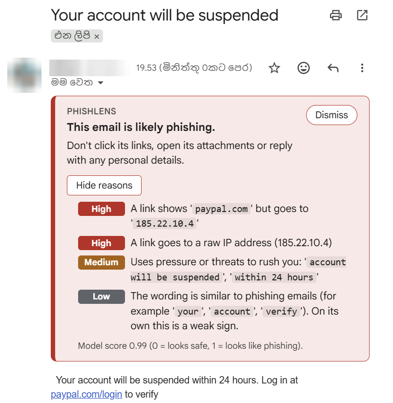
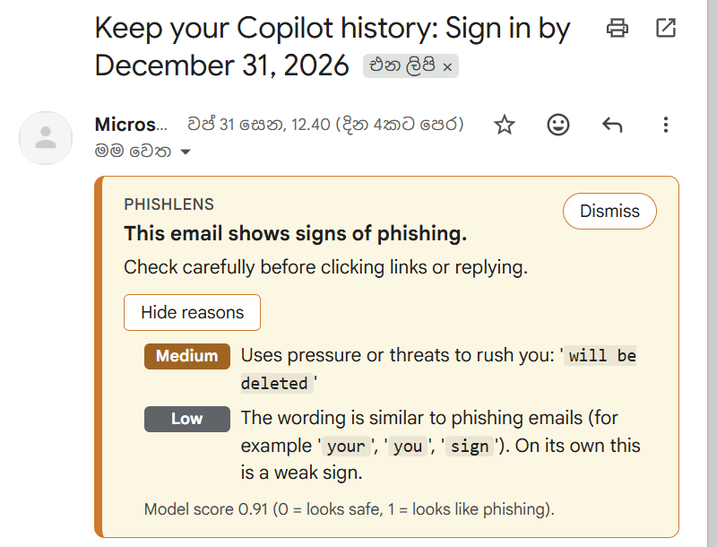
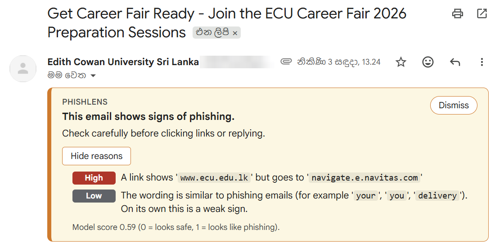
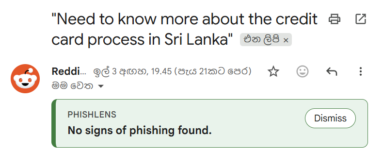
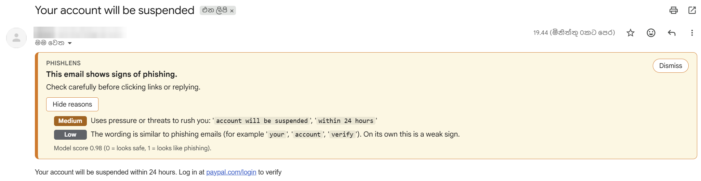

# PhishLens

A browser extension (Chrome and Microsoft Edge) that warns Gmail users about phishing
emails and explains *why* an email looks suspicious.

The analysis runs inside your browser, so email content never leaves your computer. There
is no server to install: the model is trained in Python and shipped with the extension as
a JavaScript copy that gives the same answers.

<p align="center">
  
</p>

> **Status:** Version 2.0.0 analyses emails inside the browser, so no Python is needed
> to use it. Phases 1, 2, 3 and 5 are done; see [Roadmap](#roadmap).

## Install

No Python and no server: the trained model ships inside the extension. Works in Chrome
and Microsoft Edge.

1. Download the `phishlens-extension-….zip` file from the **Assets** of the
   [latest release](https://github.com/senura111/phishlens/releases/latest).
2. Unzip it (right-click → **Extract All…**). Keep the unzipped folder somewhere it can
   stay: the browser loads the extension from that folder, so deleting or moving it
   removes the extension.
3. Load it in your browser:
   - **Chrome:** open `chrome://extensions`, turn on **Developer mode**, click
     **Load unpacked** and choose the unzipped folder (the one with `manifest.json`
     directly inside it).
   - **Edge:** open `edge://extensions`, turn on **Developer mode**, click
     **Load unpacked** and choose the same folder.
4. Open Gmail (reload the tab if it was already open) and open an email. The banner
   appears above it. Click the PhishLens toolbar icon (pin it from the puzzle-piece
   menu) to check that it says "Ready".

**To update:** download the new zip, replace the folder's contents with it, click the
reload arrow on PhishLens's card in `chrome://extensions` (or `edge://extensions`), and
reload Gmail.

To change the code or retrain the model, see [For developers](#for-developers).

## How it works

```
Gmail tab ─> content script (reads the open email)
          ─> service worker (inside the browser)
          ─> rules + ML model (JavaScript, exported from the Python model)
          ─> verdict + reasons
          ─> warning banner shown inside Gmail
```

1. When you open an email, the extension reads what Gmail shows on the page: sender name and
   address, subject, body text, links (visible text and the real destination), and
   attachment file names. Attachments themselves are never downloaded or opened.
2. It passes that to the extension's service worker, which analyses it inside the
   browser. (Before Phase 5 this went to a FastAPI server on `127.0.0.1`; that API
   still exists for development.)
3. The analyser combines rule-based checks (lookalike domains, mismatched links, urgency
   phrases, requests for passwords or gift cards, and more) with a TF-IDF + Logistic
   Regression classifier.
4. The extension shows a banner above the email: **red** for phishing, **amber** for
   suspicious, **green** for safe, with a list of human-readable reasons. **Grey** means
   the email couldn't be checked, or only partly.

## Privacy and security

- Emails are analysed inside the browser. The extension makes no network requests at
  all: it has no host permissions, and the only file it fetches is its own model.
- No email content is logged, stored, or sent anywhere. No analytics or telemetry.
  See the [privacy policy](docs/privacy-policy.md).
- The extension asks for no permissions beyond running on Gmail, and ships no remote
  code.
- The optional development API only listens on `127.0.0.1`, never on your network.
- Email content is treated as untrusted and is never inserted into the page as HTML.

## Roadmap

| Phase | What | Status |
| ----- | ---- | ------ |
| 1 | Model: preprocessing, rule-based signals, scikit-learn classifier | Done (see [Known limitations](#known-limitations)) |
| 2 | Local API: FastAPI `POST /analyze` and `GET /health` | Done (see [Local API](#local-api-phase-2)) |
| 3 | Chrome extension (Manifest V3): Gmail banner and popup | Done (see [Chrome extension](#chrome-extension-phase-3)) |
| 4 | Polish: link highlighting, toolbar badge, sensitivity setting, demo GIF | Optional |
| 5 | Browser-only: the model runs in JavaScript, no Python server; ready for Microsoft Edge Add-ons | Done (see [Browser-only analyser](#browser-only-analyser-phase-5)) |

## Model results (v1)

> **Read with care.** The test set comes from the same two datasets as the training
> set, so it shares their biases (see [Known limitations](#known-limitations)). These
> scores say the model separates *these* datasets well. Real-world accuracy on a modern
> inbox will be lower, especially on marketing and transactional email.

**Setup.** 6,785 English emails (2,762 phishing, 4,023 safe) after cleaning. That's 9
more than before the line-break fix: keeping line breaks changed some cleaned texts, so
9 fewer phishing emails count as exact duplicates. Emails whose text is at least 80%
similar (TF-IDF cosine) are grouped into one campaign: 6,035 campaigns, the largest a
29-email "your mailbox will be deactivated" campaign spanning 2016–2022.
`GroupShuffleSplit` puts 80% of campaigns in train and 20% in test, so no campaign is on
both sides: 5,441 train emails and 1,344 test emails (559 phishing, 785 safe).

**Model.** All three approaches are Logistic Regression with `class_weight="balanced"`.
The text model reads the subject and body only (TF-IDF of words and word pairs, letters
only). Brand names are replaced by a placeholder that the model ignores (see
[Brand masking](#brand-masking)). The rules go in as nine extra columns, one per rule.

### Verdict rules

| Verdict | When |
| --- | --- |
| **Phishing** (red) | score ≥ 0.8 **and** at least one high-severity rule, or two *different* medium-severity rules |
| **Suspicious** (amber) | score 0.5–0.8; or score ≥ 0.8 without such a rule; or ip_link / homoglyphs fired, whatever the score |
| **Safe** (green) | score below 0.5 and neither ip_link nor homoglyphs fired |

**Why red always needs a rule-based reason.** A red banner should point at something
concrete the user can check: a lookalike domain, a link that goes somewhere other than
it says, a sender name that doesn't match the address. The text model can't provide
that. It only knows which words phishing tends to use, and in this training data words
like "your order", "payment" and "invoice" appear *only* in phishing, because the
legitimate emails contain no receipts. On its own it can't tell a real receipt from a
fake one. One medium-severity rule isn't enough either: real password resets say "this
link expires in 24 hours", which the urgency rule flags. So the text and a single medium
rule can raise an email to amber, never to red. People stop trusting warnings that cry
wolf, and red is the warning that has to stay trustworthy.

**What it costs.** On the test set, tightening red moved **156 phishing emails from red
to amber and none to safe**. 111 of them had urgency as their only medium rule. Safe
emails were unaffected (0 red, 5 amber, before and after).

| Recall of the saved model | Before tightening | After |
| --- | --- | --- |
| Counting only red ("phishing") as caught | 0.571 | **0.292** |
| Counting red or amber as caught | 0.962 | **0.962** |

Every flagged email also gets a low-severity **phishing_language** reason naming the
words that pushed the score up, e.g. "The wording is similar to phishing emails (for
example 'your', 'order', 'payment'). On its own this is a weak sign." So an amber
banner always says why, even when no rule fired.

### Test set results

An email counts as *flagged* when it gets a red or amber banner.

| Approach | Precision | Recall | F1 | False positives | Missed phishing |
| --- | --- | --- | --- | --- | --- |
| Rules only | 0.924 | 0.714 | 0.805 | 33 | 160 |
| Text only | 0.987 | 0.975 | 0.981 | 7 | 14 |
| **Text + rules** (saved) | **0.991** | **0.962** | **0.976** | **5** | **21** |

Confusion matrices (rows = true label, columns = prediction):

| | Rules only: flagged | not flagged | Text only: flagged | not flagged | Text + rules: flagged | not flagged |
| --- | --- | --- | --- | --- | --- | --- |
| Phishing | 399 | 160 | 545 | 14 | 538 | 21 |
| Safe | 33 | 752 | 7 | 778 | 5 | 780 |

Verdicts of the saved model:

| True label | Safe | Suspicious | Phishing |
| --- | --- | --- | --- |
| Phishing (559) | 21 | 375 | 163 |
| Safe (785) | 780 | 5 | **0** |

No safe test email gets a red banner from the saved model. (The rules-only model would
give 13 safe emails a red banner, another reason it isn't used.)

**False positives by source.** `hard_ham` is legitimate mail that looks spammy
(newsletters, promotions), the closest thing in the data to modern marketing email:

| Source | Safe test emails | Rules only | Text only | Text + rules |
| --- | --- | --- | --- | --- |
| easy_ham | 483 | 13 (2.7%) | 1 (0.2%) | 2 (0.4%) |
| easy_ham_2 | 263 | 3 (1.1%) | 2 (0.8%) | 0 (0.0%) |
| **hard_ham** | **39** | **17 (43.6%)** | **4 (10.3%)** | **3 (7.7%)** |

The saved model's 5 false positives: two news items that use the word "urgent", a
technology newsletter, an online-store newsletter, and a Linux-Announce digest with a
raw-IP link (lifted by the floor). With only 39 hard_ham test emails these rates are
rough, but the pattern is clear: marketing email is where false positives come from.

**Which approach is saved: text + rules.** Its F1 is a hair lower than text only (0.976
vs 0.981), but it makes fewer false positives (5 vs 7, and 3 vs 4 on hard_ham), at the
cost of 7 more missed phishing emails out of 559.

### Brand masking

In the training data, brands like PayPal, Dropbox and USAA appear almost only in
phishing, so a text model learns "PayPal mentioned = phishing" and would flag real
PayPal email. Brand names are therefore replaced by one placeholder word before TF-IDF.
The rules still see the real names, so lookalike domains are still caught.

**What we learned from the placeholder.** As an ordinary word, the placeholder became a
strong phishing sign itself: weight +3.14, the 14th strongest of 51,203 inputs, present
in 1,063 training emails. The model no longer learned "PayPal = phishing", but it did
learn "*a brand was mentioned* = phishing", which is the same bias in one word. So the
placeholder is now a **stop word**: the vectorizer drops it before counting, and brand
mentions carry no weight at all. Spotting brand impersonation is left to the rules.

On the same split, unmasked, placeholder and ignored placeholder all give the saved
model identical test results (538 / 21 / 5 / 780). That's expected: the test set has no
genuine email from these brands. The benefit is for a real inbox, where genuine brand
email is common.

### Does the model use the rules?

Yes. A raw weight isn't comparable between a rule and a word: a fired rule column is 1
(or 2/3 for medium severity), while a word's TF-IDF value in an email is usually around
0.05–0.15. So the table shows each input's *typical push*: weight × its usual value when
present, i.e. the log-odds it adds to an email's score. Rank is out of all 51,066 inputs
(51,057 words and word pairs + 9 rules).

| Rule | Weight | Typical push | Rank | Training emails where it fired |
| --- | --- | --- | --- | --- |
| urgency | +3.69 | +2.46 | 1 | 1,052 |
| homoglyphs | +1.97 | +1.97 | 2 | 95 |
| risky_attachment | +2.60 | +1.80 | 3 | 152 |
| sender_name_mismatch | +2.50 | +1.76 | 4 | 466 |
| url_shortener | +2.08 | +1.39 | 5 | 117 |
| link_text_mismatch | +1.32 | +1.32 | 6 | 177 |
| sensitive_request | +1.23 | +1.23 | 7 | 146 |
| lookalike_domain | +1.02 | +1.02 | 8 | 126 |
| ip_link | −0.10 | −0.10 | 63 | 12 |

The strongest single words push far less: "your" +0.37, "account" +0.32, "document"
+0.25, "payment" +0.23. Text evidence adds up across many words instead: on phishing
test emails the text adds +3.23 log-odds on average and the rules +1.95; on safe emails
the rules add almost nothing (+0.08).

- **Eight rules are the eight strongest inputs** in the whole model.
- **ip_link is effectively unused by the model**: it fired in only 12 training emails,
  too few to learn from. The floor below covers it instead.

### Which part of a domain counts

Rules compare *registrable* domains, the part someone has to buy: `login.paypal.com`
and `www.paypal.com` are both `paypal.com`. Where that part ends comes from the
[Public Suffix List](https://publicsuffix.org/), bundled in the pinned
`publicsuffixlist` package and never downloaded at runtime. It replaced a hand-written
list of 28 suffixes that missed ones like `edu.lk` and `ac.lk`, so `ecu.edu.lk` and
`evil.edu.lk` counted as the same site. The list also has "private" suffixes such as
`github.io` and Amazon S3 website hosts, where every customer's site is its own.

The switch changed rule results on 2 of 6,785 emails, both phishing, both
lookalike_domain. A fake Wells Fargo site in an S3 bucket
(`wellsfargo.usa.s3-website-us-east-1.amazonaws.com`) is now caught: before, the whole
host counted as `amazonaws.com`, one of Amazon's official domains. And a host on the
`dns-cloud.net` hosting service no longer "imitates icloud.com" just because the
hosting service's own name contains "cloud". Test results (precision, recall,
confusion matrices, verdicts, false positives) are unchanged; the weights above moved
slightly after retraining.

### The "suspicious" floor (ip_link and homoglyphs only)

A fired **ip_link** or **homoglyphs** rule lifts the verdict to at least amber, whatever
the score, because these are strong phishing signs that almost never fire on legitimate
mail. It never makes an email red on its own.

A floor for *every* high-severity rule was tried and rejected. On the current test set:

| Floor applies to | Safe emails turned amber | Missed phishing caught |
| --- | --- | --- |
| All high-severity rules (rejected) | 20 of 785 (2.5%), incl. 16 of 39 hard_ham | 0 of 21 |
| **ip_link and homoglyphs** (used) | **1 of 785 (0.1%)** | **0 of 21** |

The broad version mostly hit newsletters: brand-named newsletters sent from an
email-service domain, links showing one domain and going to another, and an Outlook
add-on site at `outlook.4team.biz`. Modern marketing email does the same things. The
narrow floor catches no extra phishing on this test set; it's a safety net for
real-world phishing the training data barely covers.

In the extension, reasons on a "safe" email are shown as collapsed grey "minor notes",
not warnings, so a lone rule hit on a legitimate newsletter doesn't look alarming.

**Top 20 words of the text-only model.**

- Phishing: your, account, email, please, your account, you, dear, below, password,
  click, payment, notification, update, document, we, you have, mailbox, information,
  view, attached
- Safe: it, that, but, the, there, they, of, my, what, just, like, so, at, when, which,
  razor, linux, then, one, would

The phishing words are genuine phishing language, but also everyday transactional
language (account, payment, view, attached). The safe words are conversational style
and mailing-list topics. Formal legitimate email such as receipts and alerts looks like
neither list, which is exactly where the model goes wrong (next section).

### Modern example emails

Five hand-written emails in a modern style (in `model/tests/example_emails.py`), scored
by the saved model:

| Email | Verdict | Score | Reasons |
| --- | --- | --- | --- |
| Phishing: lookalike sender + mismatched link | **phishing** ✅ | 1.00 | link_text_mismatch, lookalike_domain (high); sender_name_mismatch, urgency (medium); phishing_language |
| Personal email between friends | **safe** ✅ | 0.07 | none |
| Marketing newsletter from a shop | **safe** ✅ | 0.25 | none |
| Password reset from Dropbox | **suspicious** ❌ | 0.98 | urgency ('expires in 24'); phishing_language ('your', 'password', 'account') |
| Receipt with a PDF invoice | **suspicious** ❌ | 0.84 | phishing_language ('your', 'order', 'payment') |

The two wrong ones are marked as expected failures in the tests, with the cause, and a
separate test checks they stay amber rather than red. Earlier in development the receipt
was red with no reason and the password reset was red; the verdict rules above are what
brought both down to an explained amber.

## Known limitations

The model is trained on public datasets: the
[Nazario phishing corpus](https://monkey.org/~jose/phishing/) (2015–2025) and the
[SpamAssassin ham corpus](https://spamassassin.apache.org/old/publiccorpus/) (2002–2003).
Preprocessing removes signals that only reveal *which dataset* an email came from:
dates, years, anonymised names, mailing-list footers, quoted replies, copyright
footers. Some biases can't be cleaned away:

- **Transactional-email bias (the biggest one).** The legitimate emails are 2002
  mailing-list posts: there are no receipts, password resets, shipping notices or
  account alerts. Words those emails always use ("your order", "your password",
  "payment", "invoice", "attached") were only ever seen in phishing. Genuine
  transactional email therefore scores high: a real receipt scores 0.84 and a real
  password reset 0.98. The verdict rules keep them amber instead of red, but they are
  still false alarms. The urgency rule adds to this for password resets, because
  genuine ones say "this link expires in 24 hours".
  A real example, seen in Gmail with the extension: Microsoft's "Keep your Copilot
  history: sign in by December 31" email gets amber (score 0.91), with the urgency
  reason quoting "will be deleted" plus phishing_language. No rule-based evidence
  fired, so the verdict rules kept it out of red, as designed, but it is still a
  false alarm.

  

  **Future fix:** train on modern legitimate transactional email (receipts, password
  resets, shipping notices, account alerts), then re-check the urgency phrases that
  genuine services use.
- **Topic bias.** Beyond transactional mail, the legitimate emails are mostly tech
  mailing lists (Linux, Perl, spam filtering). The model partly learns
  "conversational tech talk = safe", so formal, impersonal legitimate mail is more at
  risk than the test scores suggest.
- **English only.** All the legitimate emails are in English, so non-English phishing
  would teach the model "foreign language = phishing". v1 drops non-English emails
  from training (158 phishing, 8 legitimate). Results on non-English email are not
  reliable.
- **Brand clusters.** Many phishing emails copy real brand templates (USAA, DocuSign,
  WeTransfer, Google), with no genuine emails from those brands in the legitimate set.
  Brand names are masked and ignored by the text model, but the rest of a copied
  template (its footer, its phrasing) can still act as a phishing sign. Near-duplicate
  campaigns are kept on one side of the train/test split so test scores stay honest.
- **Mailing and click-tracking services.** Legitimate email sent through a mailing
  service often has links whose text shows the sender's own site while the real link
  goes to the service's click tracker. A real university newsletter shows
  "www.ecu.edu.lk" but links to a `navitas.com` tracking URL, and gets an amber
  "suspicious" verdict (score 0.59, link_text_mismatch). To the extension this looks
  exactly like phishing. The obvious fixes all weaken detection or privacy: trusting
  links on the sender's domain or allowlisting more mailing services gives phishers a
  way through (they use the same services), and following the redirect to see where
  it ends would mean contacting the link's server, which the privacy rules forbid.
  So the rule stays, and the banner shows both domains, so you can judge for
  yourself. (The rule already skips a short list of well-known trackers such as
  SendGrid and Mailchimp.)

  

- **The test set shares these biases.** It comes from the same two datasets, so the
  scores above overstate real-world accuracy.
- **Disguised file names in the body text.** A double extension like "Invoice.pdf.exe"
  is only recognised in the `attachments` field, where the warning says the file
  pretends to be a .pdf but is really a .exe. Mentioned in the body text, the same name
  is reported as the file "pdf.exe": still a high-severity warning about a program,
  but without saying it's disguised. The pattern that finds file names in text doesn't
  allow dots inside a name. **Future fix:** let it accept a harmless-looking extension
  in front of the risky one.

After changing preprocessing, re-check for shortcuts with
`python -m model.src.audit_shortcuts`.

## Local API (Phase 2)

Since Phase 5 the extension doesn't use this API; it stays as a development tool and
the Python reference, handy for trying the model with `curl`.

A small FastAPI server wraps `analyze()` so the extension can call it. It listens on
`127.0.0.1:8000` only, so nothing else on your network can reach it.

| Endpoint | What it does |
| --- | --- |
| `GET /health` | Answers `{"status": "ok"}` when the server is running |
| `POST /analyze` | Takes the email fields Gmail shows; returns a verdict, score and reasons |

The exact request and response format is the
[API contract in CLAUDE.md](CLAUDE.md#api-contract).

**The model is loaded once, at startup.** If there's no trained model, the server
refuses to start and says how to train one. So a running server always has a model,
and the extension only has to tell "running" from "not running".

### What a request must look like

- Every field except `attachments` must be present, but may be empty (`""` or `[]`).
  Real emails can have no display name, no body text (image-only emails) or no links.
  `sender_email` must not be empty: every email has a sender address.
- Unknown fields are rejected, so a typo in the extension fails loudly instead of being
  ignored.
- Length caps (characters): `sender_email` 254, `sender_name` 256, `subject` 1,000,
  each link's text and address 2,048, each attachment name 255. At most 1,000 links
  and 100 attachments. `body_text` is only limited by the 100 KB request limit.
- The request must be JSON (`Content-Type: application/json`), at most 100 KB, and
  say its size in a `Content-Length` header.

| Status | When |
| --- | --- |
| 200 | The verdict |
| 400 | The request isn't addressed to `127.0.0.1` or `localhost` |
| 411 | No `Content-Length` header (a body sent in chunks) |
| 413 | The request is over 100 KB |
| 415 | The request isn't JSON |
| 422 | A field is missing, unknown, too long or the wrong type. The response lists where and what, never the value that was sent |
| 500 | The analysis failed. The response says only "Internal server error" |

### Security design

- **No CORS.** The extension calls the API from its service worker, which its
  `host_permissions` allow without CORS. Without CORS headers, browsers don't let
  other websites read the API's answers.
- **JSON only.** A webpage can send `text/plain` or form data to any address without
  asking the server first (no CORS "preflight"). It can't send JSON without asking,
  and the API refuses to answer that question. So a webpage can't get a request
  through at all.
- **Host check.** The API only answers requests addressed to `127.0.0.1` or
  `localhost`. This blocks *DNS rebinding*, where a website points its own domain
  name at `127.0.0.1` so the browser treats the API as part of that website.
- **No email content in responses or logs.** A 422 lists where each error is and
  what's wrong, but not the value sent. A 500 says nothing about the error, and the
  log line names only the error's type (`analyze() failed with ValueError`): an
  error message or traceback can quote the email. Uvicorn's access log only records
  the client address, method, path and status.

### Security testing

`api/tests/` checks everything above against the running app. Two kinds of test
deserve a note.

**Sentinel tests.** A unique marker string stands in for email content. Tests send it
in an invalid field, in an unknown field and in broken JSON, and check that the 422
doesn't contain it. Another test makes `analyze()` fail with an error whose message
quotes the email body. It checks that the marker appears neither in the 500 response
nor in the captured log output, while the error's type name does.

**Slow inputs (ReDoS), found and fixed.** The test for a 100 KB request took 48
seconds: one email of 100 KB of "xxx..." froze the analysis. This is *ReDoS* (regular
expression denial of service). Some regexes, given a long run of characters that
can't match, tried again from every position in the run, and each attempt scanned to
the end of the run. The time grows with the square of the run's length, so an
attacker could send an email built to hang the analysis. A scan of unusual inputs
(long runs of letters, `1.1.1.`, `a.a.a.`, dashes, Cyrillic letters and more, in every
field) found four regexes with this flaw:

| Regex | Used by | Worst input before the fix (about 90–100 KB) |
| --- | --- | --- |
| `_FILE_NAME_RE`, `_PATH_WORD_RE` | `risky_attachment` | "xxx..." in the body: 48 s |
| `EMAIL_RE` | removing addresses from subject and body | "1.1.1.1..." in the body: 36 s |
| `_NAME_EMAIL_RE` | `sender_name_mismatch` | Cyrillic letters in the sender name: 45 s |

The fix makes each regex start a match only at the beginning of a run (a
*lookbehind*), so a run is scanned once. The matches are the same as before. Old and
new regexes were compared on all 7,609 raw dataset emails: identical matches, and
identical `prepare_email()` and rule output, so the saved model didn't need
retraining.

After the fix, the slowest input in the same scan takes 0.21 s for 90 KB, and time
grows in step with the input (4× the input takes about 4× as long). The length caps
also keep the short fields small. `api/tests/test_slow_inputs.py` keeps it that way:
17 patterns × 8 fields, each at the largest size the API accepts, must each be
analysed in under 1 second. They take at most about 0.3 s.

One training-only regex (`_CORPUS_ARTIFACTS` in `preprocess.py`) has the same flaw.
It only runs on the downloaded datasets, never on API requests, so it was left as is.

## Chrome extension (Phase 3)

A Manifest V3 extension in plain JavaScript, with no framework and no build step. It
has three parts, which talk to each other with `chrome.runtime.sendMessage`. (This
section describes the extension as it is after Phase 5: the service worker analyses
emails itself instead of calling the local API.)

| Part | Runs | Does |
| --- | --- | --- |
| Content scripts (`extension/content/`) | Inside the Gmail tab | Find opened emails, read them, show the banner |
| Service worker (`extension/background/`) | In the background | Loads the model and runs the analyser (`extension/analyzer/`) |
| Popup (`extension/popup/`) | When you click the toolbar icon | Shows whether the analyser is ready, and what the colours mean |

### The banner

| Banner | When |
| --- | --- |
| **Red**: "This email is likely phishing." | Verdict `phishing` |
| **Amber**: "This email shows signs of phishing. Check carefully before clicking links or replying." | Verdict `suspicious`. Most phishing lands here, because red needs rule-based evidence (see [Verdict rules](#verdict-rules)), so the wording is a clear warning |
| **Green**: "No signs of phishing found." | Verdict `safe`. Any reasons are collapsed grey "minor notes", not warnings: a lone rule hit on a legitimate newsletter shouldn't look alarming |
| **Grey**: partly analysed | Verdict `safe`, but part of the email had to be left out (see below), so it is never shown as plain green |
| **Grey**: couldn't read this email / analysis failed | No verdict: no sender address was found on the page, or the analyser failed (e.g. its model didn't load). Each has its own message and a Try again button |

**Green: a Reddit digest**



Red and amber list their reasons, with severity labels, open by default. Values a
reason quotes (domains, phrases) are highlighted, so for a mismatched link you see both
the domain the link shows and the one it really goes to. Every banner can be
dismissed; it stays dismissed until the tab is reloaded.

The two test emails below have the same words ("Your account will be suspended within
24 hours. Log in at paypal.com/login to verify"), and the model scores both about
0.99. Only the link differs. In the first, it shows `paypal.com` but goes to a raw IP
address, so the rules find hard evidence and the banner is red. In the second, the link
goes where its text says, so only the wording is suspicious, and the
[verdict rules](#verdict-rules) cap it at amber.

**A link that lies: red**


**An honest link: amber**



[docs/banner-preview.html](docs/banner-preview.html) shows every state with sample
data. Open it in Chrome; no server or extension needed.

### Reading Gmail

- **All Gmail selectors live in `extension/content/selectors.js`**, so a change in
  Gmail's markup means editing one file. They use stable attributes
  (`data-message-id`, `email`, `download_url`) where Gmail has them, and never visible
  text: Gmail's interface can be in any language (it was tested in Sinhala).
- **Gmail is a single-page app**: opening an email changes the page instead of loading
  a new one. A `MutationObserver` reports DOM changes; a burst of changes leads to one
  scan, 300 ms after the first.
- **Each message is analysed once.** Results are kept by message id in the tab's
  memory (never saved). When Gmail rebuilds a message, the banner is put back from
  memory without analysing it again.
- **Every expanded message in a thread gets its own banner**, because phishing can be
  a reply inside a real conversation from a hacked account.
- **What is read:** sender name and address, subject, body text (`innerText`, which
  leaves out text hidden with CSS, a trick for padding emails with harmless words),
  links with their real `href` (not Gmail's `data-saferedirecturl` redirect), and
  attachment file names. Attachments are never downloaded or opened.

### Fitting the analysis limits

`extension/content/payload.js` shortens each email to the caps of the API contract
(the same for the in-browser analyser and the Python API), which keep every analysis
small and fast. Anything left out is a blind spot an attacker could hide
in, so the banner then says the email was only partly analysed.

- **Invisible characters** (Unicode category Cf: zero-width spaces, soft hyphens,
  text-direction controls) are removed from free text. Phishers put them inside words
  ("pass", zero-width space, "word") so that a rule looking for "password" misses it, or use a right-to-left override to
  show "Invoice.exe" as "Invoice.jpg". The sender address and link hrefs are kept
  exactly as Gmail shows them: cleaning them could turn a fake domain into a
  real-looking one.
- **Exact duplicate links** (same text and same href) are removed before the 1,000-link
  cap. Links that share an href but differ in text are kept: one of them may be the
  link whose text lies.
- **Long values are cut from the end**, so an href keeps its domain. The cut never
  splits a character in two.
- **The 100 KB limit is counted in bytes** of the JSON actually sent (accents take 2
  bytes, emoji 4, escaped characters up to 6). If the email is too big, the body is
  shortened first but keeps its first 20,000 characters, then links are dropped from
  the end.

`tests/js/payload.test.js` has 23 tests for this, run with Node's built-in test
runner.

### Security design

- **No `innerHTML`.** The banner is built with `createElement` and `textContent`, so
  email text (which reasons can quote) always shows as text. The preview page includes
  reasons quoting `` and a `<script>` subject, and checks
  that no element is created from them.
- **Minimal permissions.** The manifest asks for no `permissions` and no
  `host_permissions` at all: the content scripts run on `https://mail.google.com/*`
  only, and the service worker needs no network access. No `tabs`, no `storage`, no
  `<all_urls>`.
- **No network requests.** The service worker's only `fetch` is the model file inside
  the extension (`tests/js/service-worker.test.mjs` checks this).
- **The service worker checks every request's shape** (the API contract's fields and
  types) before analysing it.
- **Nothing is logged but metadata.** The console shows message ids, verdicts, scores
  and reason ids, never reason messages or email content.

### Found while testing in Gmail

- A real university newsletter sent through a mailing service gets amber, because its
  link text shows the university's site while the link goes to a tracker. The rule is
  unchanged (see [Known limitations](#known-limitations)), but the reason now quotes
  the domain exactly as the link text writes it (`www.ecu.edu.lk`, not `edu.lk`).
- That led to a real detection bug: the old hand-written suffix list counted every
  S3-hosted website as Amazon's own `amazonaws.com`, which exempted all of them from
  the lookalike check; the [Public Suffix List](#which-part-of-a-domain-counts) fixed
  it.

### Extension limitations

- **Threads with several expanded messages** are handled (each gets its own banner)
  but haven't been tested in real Gmail yet, only on a test page.
- **Gmail's own clipping.** Gmail cuts off messages over about 102 KB ("[Message
  clipped]"). The extension only sees the part Gmail shows, and can't tell it was
  clipped without matching visible text, which would break in other languages. So
  such an email is analysed on its visible part without the "partly analysed" notice.
- **Gmail markup changes** can stop the extension from finding emails. Selectors were
  last checked against live Gmail on 2026-11-04.
- **The extension's own text is in English only.**

## Browser-only analyser (Phase 5)

The extension analyses emails inside the browser, with no Python server, so it can be
installed from a store by people who don't have Python. Python is still where the
model is trained and stays the reference: the JavaScript copy must give the same
answers, and tests check that it does.

```
model/src/train.py ─> model/artifacts/phishlens.joblib       (Python, as before)
model/src/export_browser.py ─> extension/analyzer/generated/  (model.json, Public Suffix List, Unicode tables)
extension/analyzer/*.js ─> the same cleaning, rules, scoring and verdict, in JavaScript
tests/js/ ─> parity tests against answers written by Python
```

| File | JavaScript twin of |
| --- | --- |
| `extension/analyzer/preprocess.js` | `preprocess.prepare_email()` and the cleaning it uses |
| `extension/analyzer/features.js` | the eight rules in `features.py`, `find_reasons`, `rule_vector` |
| `extension/analyzer/predict.js` | TF-IDF, the Logistic Regression score, `decide_verdict` (with the floor rules), the `phishing_language` reason, `analyze()` |
| `extension/analyzer/urls.js` | `urllib.parse.urlsplit`, `ipaddress`, `publicsuffixlist`, `unquote` |
| `extension/analyzer/python-compat.js` | the parts of Python's `re` and `str` the others rely on |

**The model as JSON.** `model.json` (2.6 MB) holds the 51,057 words and word pairs of
the TF-IDF vocabulary with their IDF values, one Logistic Regression weight per word
and per rule, and the intercept. Numbers are written so `JSON.parse` reads back exactly
the same floats Python had. The extension loads it once each time its service worker
starts.

**Why not use the browser's own tools?** Small differences change answers:

- JavaScript's `\w`, `\b` and `\s` only know ASCII, Python's know every alphabet, so a
  word like "café" splits differently. `pyRegex()` rewrites each Python pattern into
  an equivalent JavaScript one, and `tests/js/unicode.test.mjs` checks the character
  classes against Python for every character Unicode has.
- With IGNORECASE, Python matches "i" to the Turkish dotted İ and dotless ı;
  JavaScript doesn't. Phishing written as "unusual actıvity" must be caught by both.
- The browser's `new URL()` follows a different standard from Python's `urlsplit`
  (it turns `http://3232235777/` into `192.168.1.1` and international names into
  `xn--` form), so `urls.js` copies Python's parsing step by step.
- Python counts string lengths in characters, JavaScript in UTF-16 units, which
  matters for the 60-character quotes in reason messages when emoji are involved.

**Parity tests.** `tests/js/make_golden.py` runs our own example emails
(`tests/js/golden_emails.py`, never text from the datasets) through Python and saves
the cleaned email, rule reasons, unrounded score, verdict and final result.
`tests/js/parity.test.mjs` runs the same emails through JavaScript and requires the
same cleaned text, the same reasons, the same verdict, and a score within 1e-6.

| Check | Emails | Result |
| --- | --- | --- |
| Golden examples (committed): every rule, every verdict, invisible characters, look-alike letters, Sinhala, emoji, odd line breaks and URLs | 28 | All identical; scores within 1e-6 |
| Every email in the local datasets (not committed) | 7,609 | All identical; scores within 1e-6 |

The dataset run found one real bug in the port, invisible to the hand-written
examples: a regex translation that matched `support.my` inside `support.my-free.website`.
A golden example now covers it. The port also exposed two bugs in the Python
reference, both fixed with tests:

- A link such as `http://[oops/x.exe` made Python's `urlsplit` raise inside the
  risky-attachment rule, so **one malformed link made the whole analysis fail**: a
  phisher could switch PhishLens off for their email.
- The lookalike-domain rule looped over a Python `set`, whose order changes between
  runs, so its message could differ from run to run.

**Limits of the parity.** Unicode normalisation (NFKC) and lowercasing come from the
browser, and characters added to Unicode after Python's version (16.0) may be treated
differently. The tests skip those characters, and no real email in the datasets hit
one.

## Project layout

```
phishlens/
├── model/       # Python: preprocessing, rules, training, predict.py
├── api/         # FastAPI wrapper around the model
├── extension/   # browser extension (vanilla JS, no build step); only shipped files
│   └── analyzer/  # the JavaScript copy of the model (Phase 5)
├── tests/js/    # JS tests and golden fixtures (Node's test runner)
└── docs/        # banner preview, icon artwork, screenshots, privacy policy, store submission
```

## For developers

You only need this to change the code, run the tests or retrain the model. To just use
PhishLens, see [Install](#install).

Clone the repository first:

```bash
git clone https://github.com/senura111/phishlens.git
```

### Model (Phase 1)

Retraining needs Python 3.11+. From the repo root on Windows:

```bash
py -m venv .venv
.venv\Scripts\python -m pip install -r model/requirements.txt
```

Download the datasets as described in [model/data/README.md](model/data/README.md), then:

```bash
.venv\Scripts\python -m model.src.preprocess        # dataset summary
.venv\Scripts\python -m model.src.audit_shortcuts   # check for dataset shortcuts
.venv\Scripts\python -m model.src.features          # how often each rule fires
.venv\Scripts\python -m model.src.train             # train, evaluate, save the model
.venv\Scripts\python -m pytest                      # run the tests
```

Training saves `model/artifacts/phishlens.joblib` (about 1 MB). It is not committed;
run the training step to create it.

To analyse one email from Python (the API wraps this):

```python
from model.src.predict import analyze

analyze({
    "sender_name": "PayPal Service",
    "sender_email": "service@paypal-account-review.com",
    "subject": "Action required: your account has been limited",
    "body_text": "Please confirm your account details within 24 hours.",
    "links": [{"text": "https://www.paypal.com/signin",
               "href": "http://paypal-account-review.com/login.php"}],
})
# -> {"verdict": "phishing", "score": ..., "reasons": [{"id": "link_text_mismatch", ...}, ...]}
```

### Local API (Phase 2)

Train the model first (see above). Then, from the repo root:

```bash
.venv\Scripts\python -m pip install -r api/requirements.txt
```

```bash
.venv\Scripts\python -m uvicorn api.main:app --host 127.0.0.1 --port 8000
```

Start it from the repo root: the API imports the model as `model.src.predict`, which
Python only finds from there. Keep `--host 127.0.0.1`; never use `0.0.0.0`, which would
open the API to your network.

To try it, open <http://127.0.0.1:8000/docs> (FastAPI's interactive docs), or from
Git Bash:

```bash
curl http://127.0.0.1:8000/health
```

```bash
curl -X POST http://127.0.0.1:8000/analyze -H "Content-Type: application/json" -d '{"sender_name": "PayPal Service", "sender_email": "service@paypal-account-review.com", "subject": "Your account has been limited", "body_text": "Please confirm your account details within 24 hours.", "links": [{"text": "https://www.paypal.com/signin", "href": "http://paypal-account-review.com/login.php"}]}'
```

The tests run with the rest: `.venv\Scripts\python -m pytest`.

### Browser extension from source (Phases 3 and 5)

No Python needed to run it: the trained model ships inside `extension/`. Load it like
the release zip in [Install](#install), but choose the repository's `extension` folder.

After changing the extension's code, click the reload arrow on its card in
`chrome://extensions`, then reload the Gmail tab: the old content script stays in an
open tab until it's reloaded.

The JavaScript tests need [Node.js](https://nodejs.org/) 22 or later, with no
packages to install. They live outside `extension/`, so the folder holds only files
that ship:

```bash
node --test tests/js/
```

After retraining the model (or changing the Python rules or cleaning), export it and
regenerate the golden fixtures, then run both test suites:

```bash
.venv\Scripts\python -m model.src.export_browser
.venv\Scripts\python -m tests.js.make_golden
.venv\Scripts\python -m pytest
node --test tests/js/
```

With the datasets downloaded, `.venv\Scripts\python -m tests.js.make_golden --corpus`
also writes Python's answers for every dataset email to `model/data/` (gitignored);
the next `node --test tests/js/` then checks JavaScript against all of them.

To package a release (the zip attached to the GitHub release, and the one a store
takes), run both test suites, then zip the *contents* of `extension/` so `manifest.json`
is at the top level of the zip, and name it `phishlens-extension-v<version>.zip` with
the version from `manifest.json`. The Microsoft Edge Add-ons submission (listing
text, images, certification notes and the store zip) is in
[docs/store/](docs/store/README.md).

## License

[MIT](LICENSE) © 2026 Senura Nimthaka
